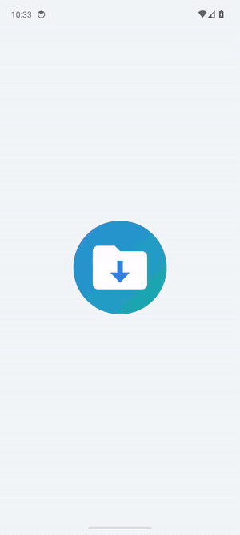
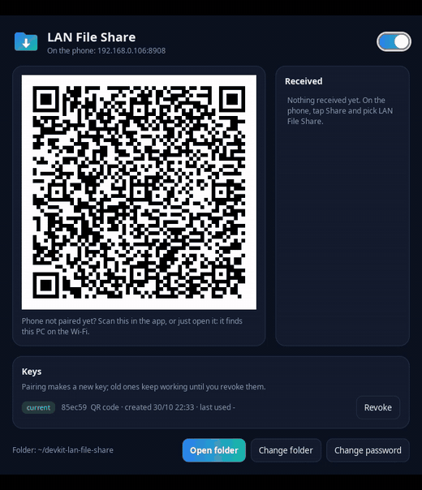
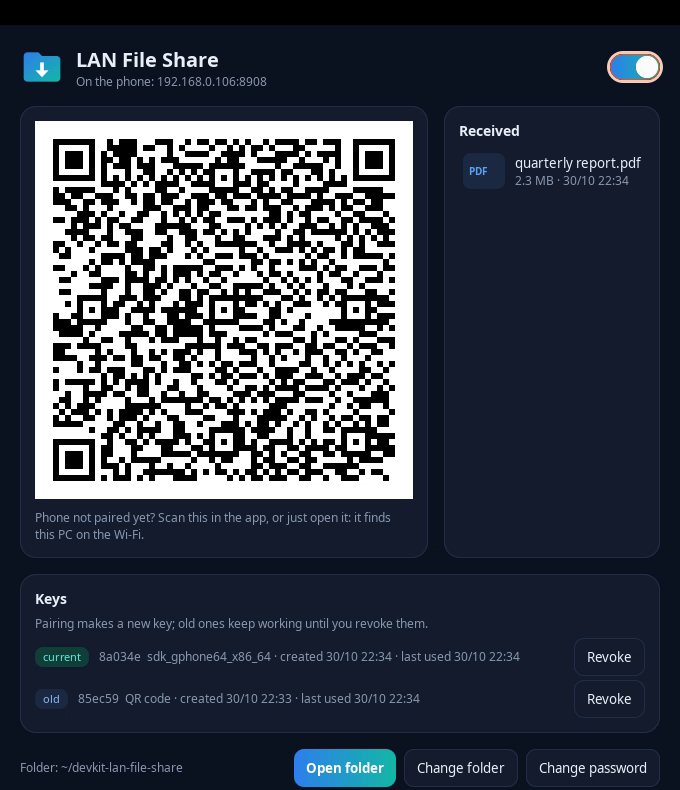

<div align="center">


# LAN File Share

**Share anything from an Android phone to a folder on your PC, over your own Wi-Fi. No cloud, no account.**


[](https://github.com/gabrielogregorio/devkit-lan-file-share/actions/workflows/tests.yml)
[](https://github.com/gabrielogregorio/devkit-lan-file-share/actions/workflows/check-quality.yml)
[](https://github.com/gabrielogregorio/devkit-lan-file-share/actions/workflows/codeql-analysis.yml)

<br>


&nbsp;&nbsp;


</div>

## About

Two pieces talk to each other on the local network:

- 🖥️ **PC:** a top bar icon that turns a receiving server on and off, and a panel with the pairing QR code, the switch,
  the files received and the keys.
- 📱 **Phone ([android/](android/README.md)):** an app that shows up in the Android share sheet. Open a PDF, tap Share,
  pick **LAN File Share**, and it lands in the PC folder. Text and links arrive as `.txt`.
- 🔒 **Encrypted and paired:** TLS with a pinned certificate, a QR code that carries a key, keys that rotate on every
  pairing and stay listed until you revoke them.
- 🧾 **Nothing is lost or replaced:** every file is compared by SHA-256, a taken name gets a number, an upload cut
  short leaves nothing behind, and the disk keeps 1 GB free.

> **Same network required.** The phone and the PC must be on the same Wi-Fi or router. Nothing goes through the internet,
> and a guest Wi-Fi with client isolation blocks it.

Phone to PC only for now. The API is versioned (`/api/v1`) so the other direction can be added later.

## Set up on a new PC

Built and tested on Ubuntu 24.04.

1. **Install the system packages and clone:**
   ```bash
   sudo apt install python3 python3-gi gir1.2-ayatanaappindicator3-0.1 python3-segno openssl libnotify-bin
   git clone <repo-url> devkit-lan-file-share
   cd devkit-lan-file-share
   ```
2. **Put the icon on the bar.** It starts with every login, off:
   ```bash
   ./tray_icon.py --install   # login entry and app menu shortcut
   ./tray_icon.py             # show it now
   ```
3. **Open port 8908** (TCP and UDP) on the LAN if you use a firewall.
4. **Install the app** on the phone: [android/README.md](android/README.md).

The server uses only the Python standard library, so there is no venv to run it.

What stays out of the repository, in `~/.config/devkit-lan-file-share`: `config.json`, `cert.pem`, `key.pem` and
`keys.json`. The log and the icons live in `~/.cache/devkit-lan-file-share`.

## Available scripts

| Command | What it does |
| --- | --- |
| `./tray_icon.py` | Shows the icon |
| `./tray_icon.py --panel` | Shows the icon and opens the panel |
| `./tray_icon.py --install` / `--remove` | Adds or removes the login entry and the menu shortcut |
| `./run.sh` | Runs the server in the terminal, without the icon |
| `./setup-dev.sh` | Creates `.venv` with the development tools, hash-checked |
| `./run-tests.sh` | Lint, types and every test that needs no emulator |
| `RUN_E2E=1 ./run-tests.sh` | Also the APK on the emulator |
| `android/build.sh` | Builds the APK |
| `android/test.sh` | JUnit, including the app's network code against the real server |
| `e2e/setup-maestro.sh` | Installs the pinned Maestro, hash-checked |
| `e2e/emulator.sh` / `e2e/emulator.sh stop` | Boots or stops the headless emulator, capped in memory |
| `e2e/run.py [step ...]` | Builds the APK and runs the flows on the emulator |
| `e2e/record_demos.py` | Records the GIFs and screenshots of this README |

## Usage

1. Turn on **On** in the icon. The panel opens with the QR code.
2. On the phone, tap **Scan QR code**. Without a camera, just open the app: it finds the PC on the Wi-Fi and pairs with
   the password (`1234` until you change it in the icon menu).
3. Share from any app, or tap **Send files**.

Files land in `~/devkit-lan-file-share`, or the folder chosen in the panel. The icon is gray when off and colored on air,
and a middle click toggles it. Only errors notify. Unchecking **On** is how it turns off: there is no Quit.

<div align="center">

</div>

## Settings

| Variable | Meaning |
| --- | --- |
| `LFS_PORT` | Port, default 8908 |
| `LFS_CONFIG_DIR` | Config folder |
| `LFS_NAME` | Name the phone shows for this PC, default the hostname |
| `LFS_LANG` | Language of the icon and the panel, otherwise the system one (en, pt-BR) |

`server/settings.py` is the only module that reads the environment.

## Architecture

```
┌───────────────┐  UDP discovery   ┌────────────────────────────────┐
│ Android app   │ ───────────────▶ │ server/ (Python standard lib)  │
│ share sheet,  │  pinned TLS 1.2+ │  hello, pair, files            │
│ UploadService │ ◀──────────────▶ │  Inbox ─▶ ~/devkit-lan-file-…  │
└───────────────┘   HMAC proofs    └───────────────┬────────────────┘
                                                   │ keys.json, config.json
                                   ┌───────────────┴────────────────┐
                                   │ tray/ (GTK): icon and panel    │
                                   └────────────────────────────────┘
```

The server reads the config on every request, so a new password or folder applies with no restart.

| Document | Content |
| --- | --- |
| [docs/api.md](docs/api.md) | The protocol: discovery, pairing link, proofs, routes, errors |
| [docs/security.md](docs/security.md) | What protects what, and what to keep in mind |
| [docs/release.md](docs/release.md) | How a release happens, the signed APK, updating dependencies |
| [docs/adr/](docs/adr/) | Why it is built this way |
| [android/README.md](android/README.md) | The app: build, code split, permissions |
| [CLAUDE.md](CLAUDE.md) | Rules for whoever changes the code, person or agent |

## Security

TLS 1.2+ with a pinned certificate, proofs in both directions that never send the secret, 256-bit keys that rotate on
pairing, a lockout after 5 wrong tries, and only the local network is served. The details are in
[docs/security.md](docs/security.md).

- Pairing by password with the default `1234` is weak: anyone on your Wi-Fi can guess it. Change it, or pair only by QR
  code.
- A photo of the QR code is a working key until you revoke it in the panel.

## Tests

| Suite | Where | What it covers |
| --- | --- | --- |
| PC unit | `server/*_test.py`, `tray/*_test.py`, next to the code | Names, keys, lockout, disk guard, config, body parsing, routes, panel data, translations |
| PC E2E | `tests/test_process_e2e.py`, `tests/test_panel_e2e.py` | The real server as a process: a whole phone journey, a restart, a killed upload; the panel on a virtual screen |
| Repository rules | `tests/test_repository_rules.py` | App strings in both languages, flows using real ids, one module reading the environment |
| App unit | `android/test/` | Proofs, names, QR link, key list, failure reasons, pairing plan |
| App E2E | `android/test/.../PcClientE2ETest.java` | The app's real network code on a JVM against the real server |
| Emulator E2E | `e2e/` | The real APK on an Android emulator, driven by Maestro against the real server |

`tests/vectors.txt` holds proofs that Python and Java are both tested against, so the two sides cannot drift apart.
`./run-tests.sh` runs everything but the emulator and ends with `ALL GREEN`. Coverage under 90% fails the run.

### On the emulator

It needs the Android SDK from [android/README.md](android/README.md), the `emulator` package, KVM, Java 17+ for Maestro
and the system image below.

```bash
sdkmanager "emulator" "system-images;android-34;google_apis;x86_64"
e2e/setup-maestro.sh    # once
e2e/emulator.sh         # about 3 GB of RAM
e2e/run.py              # about 4 minutes
e2e/emulator.sh stop
```

It covers pairing by discovery with a wrong and a right password, a pairing link that is declined and one that is
accepted, the key rotation, a real file sent through the Android share sheet by another app, a shared text, a 30 MB
file from the app's picker, a refused upload shown in the app, and the PC going off and coming back. Files are compared
by hash on the PC. Reports and screenshots land in `e2e/out/`.

| Variable | Meaning |
| --- | --- |
| `E2E_DEVICE` | Emulator serial, default `emulator-5554` |
| `E2E_EMULATOR_PORT` | Console port of `e2e/emulator.sh`, default 5554; use another when an emulator is already running |
| `E2E_EMULATOR_RAM_MB` | Emulator memory, default 3072 |
| `E2E_EMULATOR_CORES` | Emulator cores, default 3 |
| `E2E_EMULATOR_ARGS` | Extra emulator arguments |

Three refusals protect real data:

- It refuses anything that is not an emulator, even with a phone plugged in.
- It refuses an emulator of another project, since it installs an app and changes settings.
- It refuses to start if port 8908 is in use. The emulator's broadcast reaches this PC, so it would find a running
  server and pair with it. Turn off the icon first.

Not covered by automated tests: reading a QR code with a real camera. The scanner, the camera preview and the link it
hands over are tested apart; the image from the lens is not.

## CI/CD

Five workflows, with every action pinned to a commit hash:

| Workflow | When | What it does |
| --- | --- | --- |
| `tests.yml` | Push and PR to `main` | Lint, types, pytest, JUnit, the APK build, then the emulator E2E on KVM |
| `check-quality.yml` | Push and PR to `main` | Ruff, mypy, ShellCheck, executable scripts, pinned actions, valid YAML, lock and requirements agreeing |
| `codeql-analysis.yml` | Push, PR and weekly | Security analysis of Python, Java and the workflows |
| `auto-complete-fields.yml` | PR to `main` | Refuses a released version, assigns, labels, lists the commits, sets the title |
| `create-tag-and-release.yml` | PR merged into `main` | Creates the tag and the release, with checksums, see [docs/release.md](docs/release.md) |

Work happens on `dev`, and a PR into `main` with `VERSION` bumped makes a release.

## Dependencies

The server has none at runtime. Nothing is installed without matching a pinned hash:

| What | How it is pinned |
| --- | --- |
| Python dev tools | `uv.lock`, exported to `requirements-dev.txt`, installed with `pip --require-hashes` |
| Android jars | `android/libs.lock` (SHA-256). `android/fetch-libs.sh` refuses and removes a jar that differs, on every build and test run |
| Maestro | `e2e/maestro.lock` (SHA-256 published on its release), checked before unpacking |
| GitHub Actions | Full commit hash in the workflow, so a moved tag changes nothing |
| The APK | `android/build.sh` verifies the signature, writes `lan-file-share.apk.sha256` and checks both again before installing |
| System packages | `apt`, which verifies its own signatures |

## Limitations

- Phone to PC only.
- Linux with a GNOME-style top bar: the icon needs AyatanaAppIndicator.
- The app is signed with the debug key until the release secrets exist: [docs/release.md](docs/release.md).

## License

MIT. The app bundles ZXing core under the Apache License 2.0.
