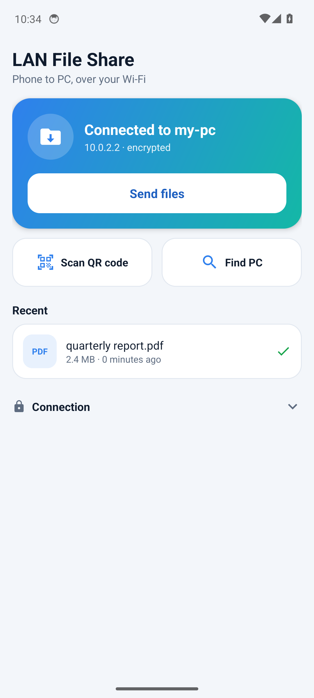
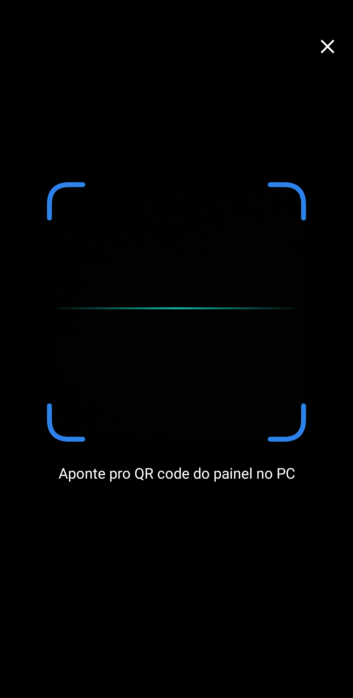

<div align="center">


# LAN File Share for Android

The phone side: send anything to your PC from the Android share sheet.


</div>

<p align="center">
  
  &nbsp;&nbsp;
  
  &nbsp;&nbsp;
  
</p>

## About the app

- Appears as **LAN File Share / Send to PC** in the share sheet of any app, for one or many files, and for text and links.
- **Send files** picks files inside the app.
- **Scan QR code** pairs with the panel on the PC. **Find PC** pairs over the Wi-Fi with the password. The address can also be typed under Connection, as `host` or `host:port`.
- A pairing link opened from another app asks before pairing, so nothing can redirect your shares in silence.
- Uploads run in a foreground service with a progress notification, so they survive leaving the app.
- If the PC changed IP, the app finds it again by its certificate.
- Interface in English and Brazilian Portuguese, light and dark, following the system.

Requires Android 7.0 (API 24) or newer; it targets API 36. The installed size is under 300 KB.

## Set up on a new PC

You need the Android SDK (build-tools 36.0.0 and platform 36), a JDK with `javac`, `curl` and `zip`. Gradle is not used. The debug key is created on the first build when it does not exist.

```bash
./build.sh           # APK in build/, signature checked, SHA-256 alongside
./build.sh install   # also installs it over adb, after checking both again
./test.sh            # unit and E2E on the JVM, no device needed (JDK, python3 and openssl)
```

The APK on an emulator is in the [main README](../README.md#tests). `ANDROID_HOME` and `JDK_BIN` override where the tools are. `ANDROID_KEYSTORE`, `ANDROID_KEYSTORE_PASSWORD` and `ANDROID_KEY_ALIAS` make it a release build signed with that key, see [docs/release.md](../docs/release.md). The jars listed in `libs.lock` are downloaded to `libs/` and checked by SHA-256; a jar that does not match is refused and removed.

## How the code is split

| File | Role | Android API |
| --- | --- | --- |
| `Protocol.java` | HMAC proofs, must match `server/proofs.py` | No |
| `Names.java` | File names and labels | No |
| `PairLink.java` | Validates the link in the QR code, decides when it needs confirmation | No |
| `PairingPlan.java` | Decides whether a pairing rotates the key or only reconnects | No |
| `KeyRing.java` | The list of received keys and which secrets to try | No |
| `Failure.java` | Turns an error into the reason the person reads | No |
| `PcClient.java` | Discovery, pinned TLS, pairing, upload | No |
| `PairingStore.java` | What the phone remembers: pairing, password, keys | Yes |
| `History.java` | Recent transfers | Yes |
| `MainActivity.java` | Status, pairing and history | Yes |
| `ShareActivity.java` | Share sheet entry, no screen of its own | Yes |
| `UploadService.java` | Foreground upload and notifications | Yes |
| `ScanActivity.java`, `ScanOverlay.java` | Camera and QR reading | Yes |

The classes free of the Android API are what `test.sh` compiles and runs on a plain JVM, so the network code under test is the code that ships.

## Permissions

| Permission | Why |
| --- | --- |
| `INTERNET` | Reach the PC on the LAN |
| `CAMERA` | Read the QR code, asked on first use |
| `POST_NOTIFICATIONS` | Upload progress and result |
| `FOREGROUND_SERVICE`, `FOREGROUND_SERVICE_DATA_SYNC` | Keep uploading outside the app |
| `WAKE_LOCK`, `ACCESS_WIFI_STATE` | Keep the Wi-Fi awake during an upload |

Cleartext traffic and backups are off. Pairing data stays in the app's private storage.

## Third-party code

[ZXing core](https://github.com/zxing/zxing) reads the QR code, under the Apache License 2.0.
